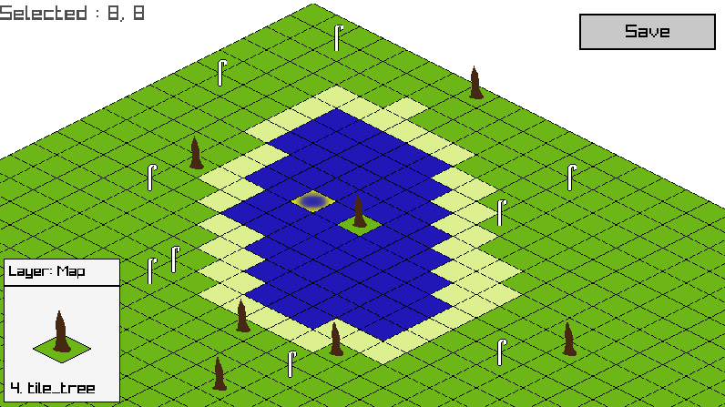
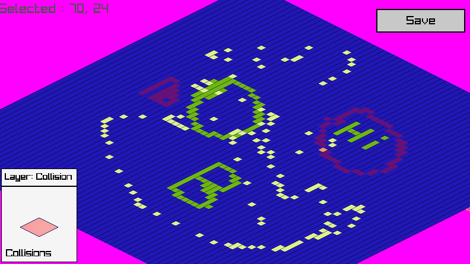
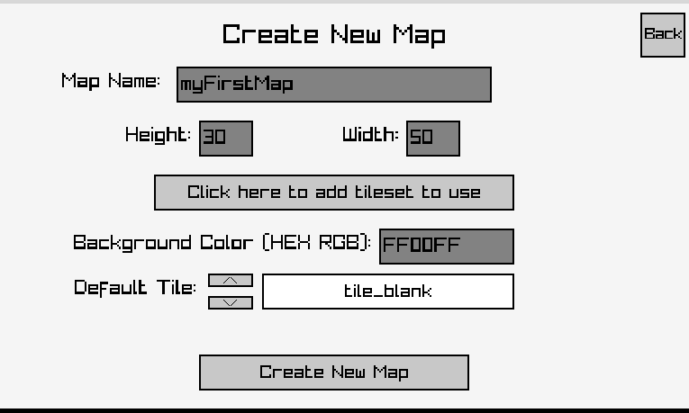
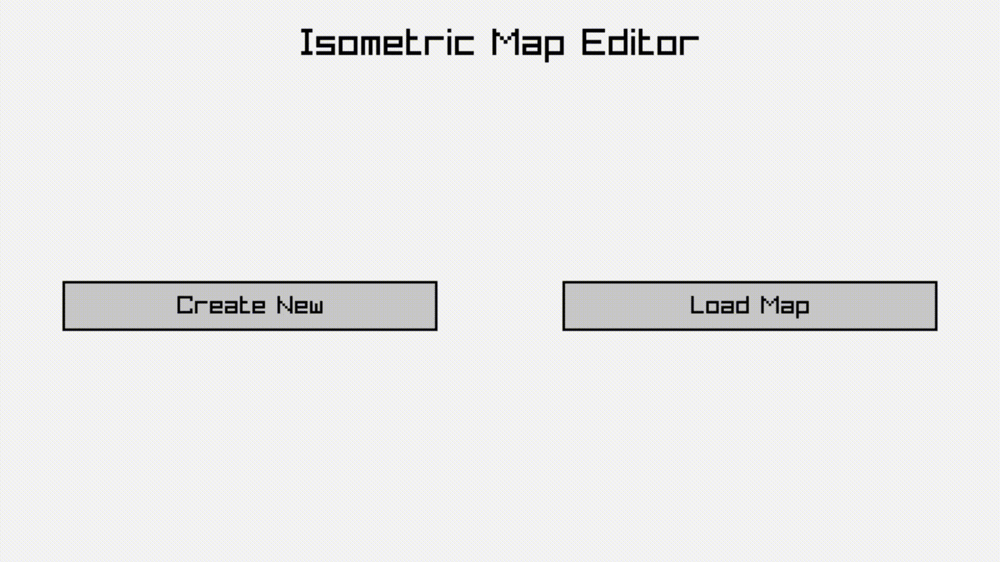

# Isometric Map Creator
### By Boraz10

## Description

A propriotary map creator for a game I plan on making. It works with specific '.tileset' files, and save in the .bormap file format.
The program allows for loading custom tilesets and creating a map with it, including a layer for collision, in a simple, easy to understand editor.
Maps can be saved and loaded at any time. 
NOTE: File selection only works with distros that support tinyfiledialogs. It will work on Windows, MacOS, and certain Linux distros, but i couldn't get it working on Arch for example. 

### Load Custom Tilesets
.tileset files are a text file which next to (in the same directory as) a png of the tileset you intend to use. In order, the file describes the name, default tile size, and the name, location and demensions of each tile on the tile map: tile_name x y width height
For example:

basic1.png \
64 32 \
tile_blank 0 0 64 32 \
tile_grass 64 0 64 32 \
tile_water 128 0 64 32 \
tile_post 0 32 64 64 \
tile_tree 64 32 64 64 \
tile_sand 128 64 64 32 

The basic tileset is included in the build, and is the default tileset used if no other tileset is selected. 
There does not currently exist a streamlined workflow for constructing tilesets. They need to be constructed manually.
NOTE: This editor is designed to mainly work with isometric tiles with a width of 64. Taller tiles may be allowed.

### Editor controls
The view of the editor can be moved with the mouse:
    Pan: Click and drag right mouse
    Zoom: Middle mouse button
    NOTE: On trackpads, the zoom may be a little finicky, it's the same motion for scrolling. 

Arrow keys change the block that you currently want to place
The up arrow key toggles between the map layer and the collision layer

To place a block, hover over the tile with your mouse, and left click.

### Creating a Map
Hit the 'Create' button on start up to make a new map. Then, you can input info such as the name of the map, the width and height (in tiles), the tileset you want to use, and the backhround colour for the map. You can also specify the default tile, the tile which will fill the whole world when the map is created. 

### Bormap files 
The maps save to a custom file format, called .bormap (short for Boraz map).
The file itself describes the name of the map, the path to the tileset in use, the background colour, the width and height of the map, and an array of (tile, collision) pairs.

## In action

### License

This project sources are licensed under an unmodified zlib/libpng license, which is an OSI-certified, BSD-like license that allows static linking with closed source software. Check [LICENSE](LICENSE) for further details.

*Copyright (c) 2026 Boraz10*
